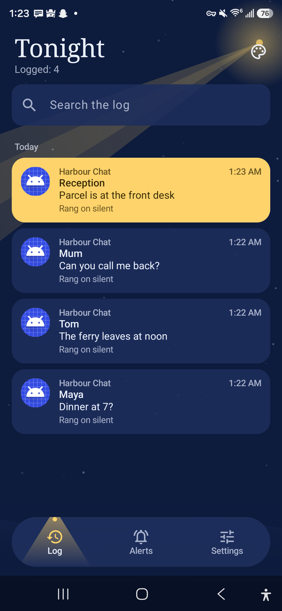
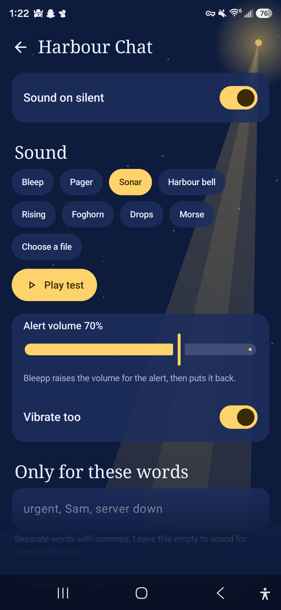
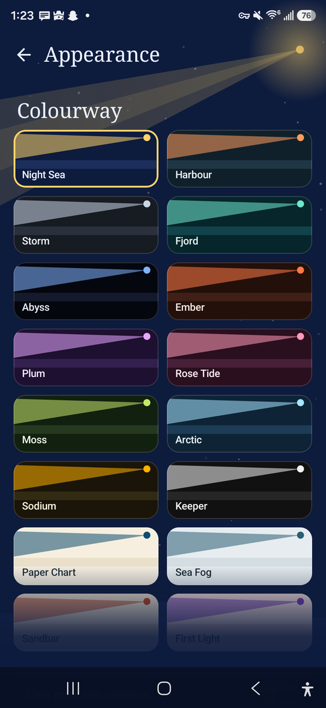
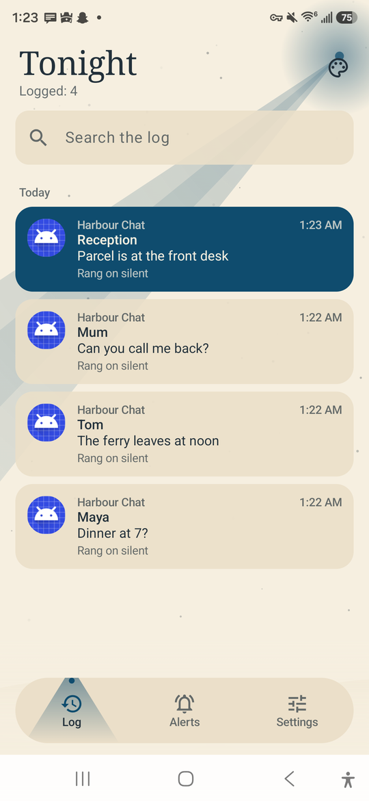

<p align="center">
  
</p>

<h1 align="center">Bleepp</h1>

<p align="center">
  <b>Hear the notifications that matter, even on silent.</b><br>
  Per-app alert sounds and a searchable notification log for Android. No root, no ads, no tracking.
</p>

<p align="center">
  <a href="../../releases/latest">Download</a> · <a href="CHANGELOG.md">Changelog</a> · <a href="https://ko-fi.com/vvanadium">Support on Ko-fi</a>
</p>

<p align="center">
  <a href="../../releases/latest"></a>
  
  
  <a href="LICENSE"></a>
</p>

<p align="center">
  
  
  
  
</p>

## Why I made it

Putting your phone on silent is all or nothing. I wanted my phone quiet except for the few apps I can't afford to miss, and I wanted a record of every notification, including the ones I swiped away too fast to read.

## What it does

**Silent alerts**
- Pick any app and give it its own sound. It plays when your phone is on silent or vibrate, and stays out of the way when your phone can ring.
- Choose from 8 built-in sounds or use your own audio files.
- Set a volume per app. Bleepp raises the volume for the alert, then puts it back.
- Only sound for certain words, like a name or "urgent".
- Repeat until seen, stopping when you open or clear the notification.
- Quiet hours, and a minimum gap between alerts so a busy group chat can't spam you.
- Break through Total Silence Do Not Disturb, for the apps you choose.

**Notification log**
- Keeps the app, time, title and message of everything that arrives.
- Search it, or filter by app.
- Tap an entry to jump to where the notification pointed.
- Skips music players and progress bars unless you want them, and you can leave any app out.
- Stamps each entry with what happened, like "Rang on silent".

**Make it yours**
- 16 colourways, or build your own and save it.
- Animated backgrounds: Beam, Tide, Stars, Rain, Fog and Aurora.
- Adjust animation speed and strength, corner roundness and heading style.
- 6 app icons.
- 23 languages, with right-to-left layouts.

## Install

1. Download the APK from the [latest release](../../releases/latest).
2. Open it and allow the install.
3. Open Bleepp and tap **Turn on** to give it notification access.

**Is notification access greyed out?** Android blocks it for apps installed from a file. Open Bleepp's App info, tap the three-dot menu, choose **Allow restricted settings**, then try again. Bleepp walks you through this too.

**Choose Unrestricted battery** in Settings → Setup, so your phone doesn't put Bleepp to sleep and make it miss alerts.

Bleepp checks this repo for new versions and tells you when one is out. You can turn that off in Settings → Updates.

## How it works

No root or LSPatch needed. Bleepp reads notifications through Android's normal notification access, then plays the sound itself on an audio stream the silent switch doesn't touch.

| Your phone is on | Normal alert | With Break through Total Silence |
| --- | :---: | :---: |
| Silent or vibrate | Plays | Plays |
| Do Not Disturb, Priority or Alarms only | Plays | Plays |
| Do Not Disturb, Total Silence | Stays quiet | Plays |

These were tested by ear on a Galaxy S25 Ultra (Android 16) and a Moto G 5G 2024 (Android 15). Other phones may behave differently. [docs/AUDIO.md](docs/AUDIO.md) has the details, including the surprises.

### Good to know

- Tapping a log entry opens the exact place while the notification is showing or until Bleepp restarts. After that it opens the app, because Android can't save tap actions.
- Android 15 and newer can hide one-time codes from notification apps, so those may appear in the log without the code.
- Android 17 has new rules for background audio. Bleepp is built to follow them, but it hasn't been tested on Android 17 yet.

## Privacy

Notification access is a lot of trust, so here's the short version:

- Your log stays on your phone. It's left out of Android backups and device transfers.
- Nothing from your notifications is ever sent anywhere.
- There are no accounts, analytics, ads or trackers, and no Google Play Services.
- The only network request is a version check against GitHub, which you can turn off.

| Permission | What it's for |
| --- | --- |
| Notification access | Seeing notifications, for alerts and the log |
| Show notifications | The Stop button and update notices |
| Foreground service | Android requires one while a sound plays |
| Modify audio settings | Raising the volume for an alert, then restoring it |
| Exact alarm | Lets alerts start reliably from the background |
| See installed apps | App names and icons, and opening apps from the log |
| Ignore battery optimisation | Asking to stay running, if you allow it |
| Internet | The GitHub version check |

More in [SECURITY.md](SECURITY.md), including how to check your copy is official.

## Build it yourself

You'll need JDK 17 or newer and the Android SDK (platform 36).

```bash
git clone https://github.com/starlightjulie/Bleepp.git
cd Bleepp
./gradlew assembleDebug
```

The APK ends up in `app/build/outputs/apk/debug/`. Run the tests with `./gradlew testDebugUnitTest`.

| Folder | What's in it |
| --- | --- |
| `app/src/main/java/com/bleepp/alert` | Deciding when to sound, and playing it |
| `app/src/main/java/com/bleepp/listener` | Reading notifications and opening them again |
| `app/src/main/java/com/bleepp/data` | The log, rules, settings and update check |
| `app/src/main/java/com/bleepp/ui` | Screens, themes and animated backgrounds |
| `tools/` | Generators for translations, sounds and icons |

## Translations

Bleepp comes in English, 简体中文, हिन्दी, Español, Français, العربية, বাংলা, Português (Brasil), Русский, اردو, Bahasa Indonesia, Deutsch, 日本語, Naijá, العربية المصرية, मराठी, తెలుగు, Türkçe, தமிழ், 粵語, Italiano, Tiếng Việt and 한국어.

I'm not a native speaker of most of these, so corrections are very welcome. [tools/i18n/README.md](tools/i18n/README.md) explains how the files work.

## Support

Bleepp is free and open source. If it's been useful to you, you can buy me a coffee on Ko-fi:

<a href="https://ko-fi.com/vvanadium"></a>

## Licence

Made by [StarlightJulie](https://github.com/starlightjulie). Bleepp is free software under the [GNU GPL version 3](LICENSE), with [additional terms](ADDITIONAL-TERMS.md) covering the author credit and the Bleepp name and logo.
